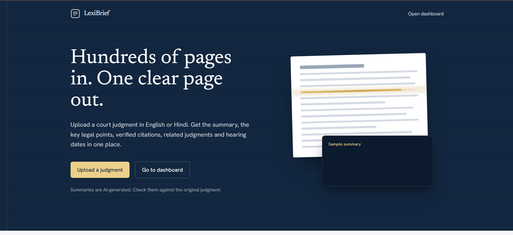
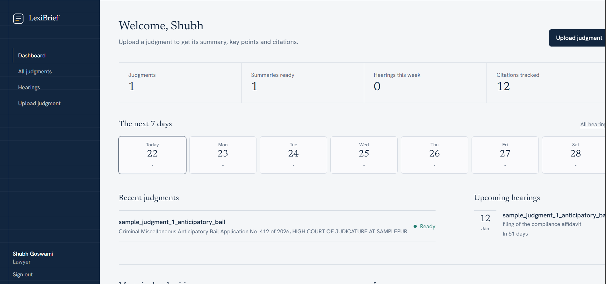
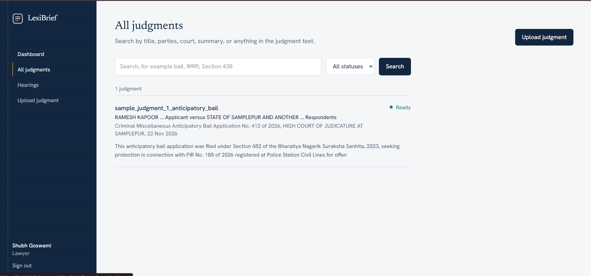
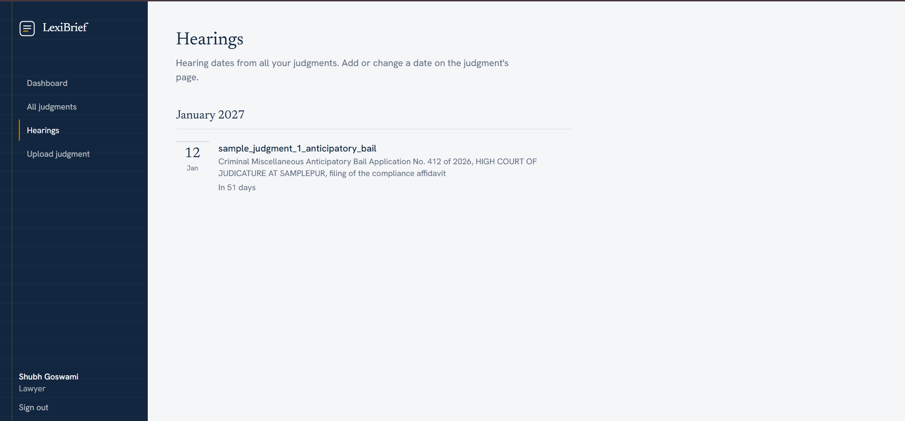
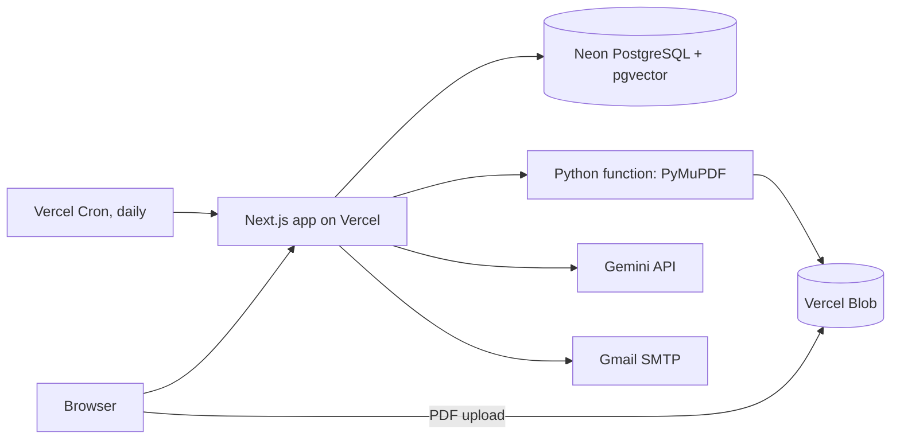
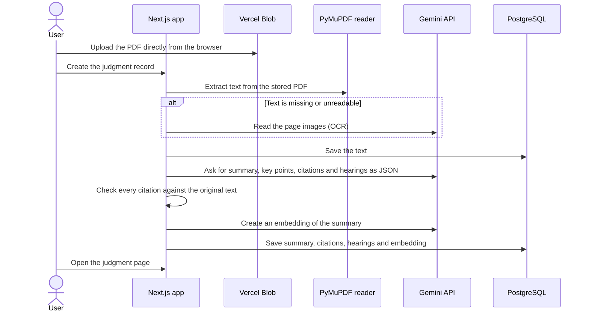
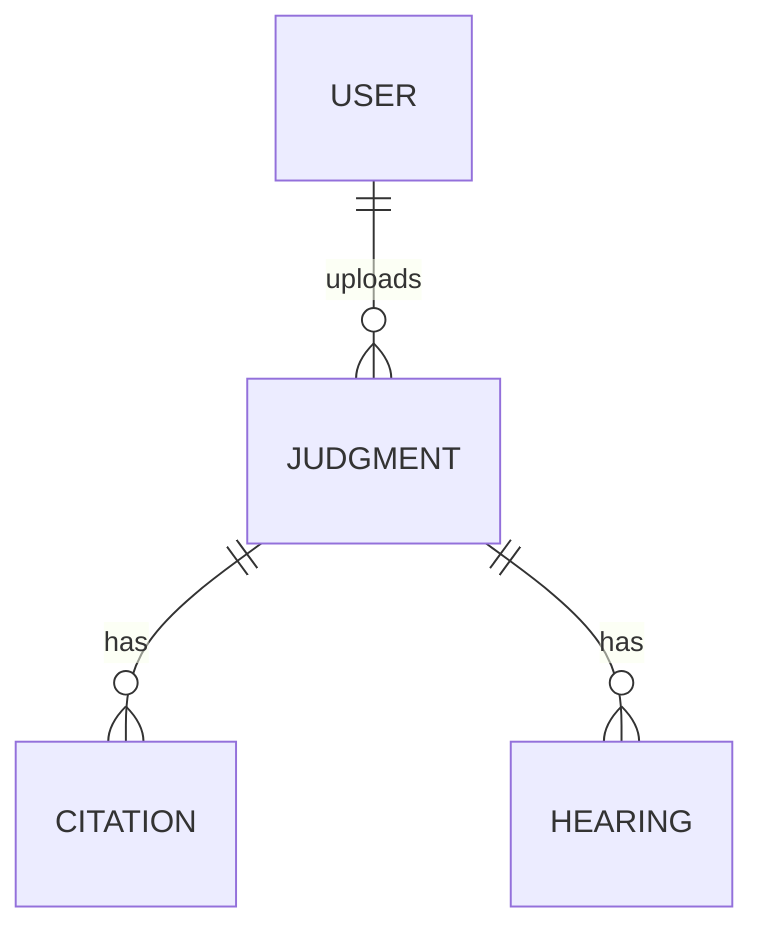

# LexiBrief

**AI-powered legal intelligence and case management for court judgments.**

Lawyers and court officials upload lengthy judgments (English or Hindi, typed or scanned). LexiBrief produces a concise summary, the key legal points and verified citations, finds similar judgments, and keeps track of upcoming hearings with email reminders.

[](https://github.com/Shubhgoswami064/LexiBrief-AI-Powered-Legal-Intelligence-Case-Management-Platform/actions/workflows/ci.yml)

**Live demo:** https://lexi-brief-ai-powered-legal-intelli.vercel.app/

---

## Screenshots

| Landing page | Dashboard |
|---|---|
|  |  |

| Judgment page | Hearings |
|---|---|
|  |  |

---

## Why this project

A judgment can run to 50 pages or more, and nobody has time to read every one before a hearing. LexiBrief does the first pass: what the case was about, what the court decided, which earlier cases it relied on, which other judgments in the library are related, and when the next hearing is.

## Features

| Area | What it does |
|---|---|
| **Upload** | Drag-and-drop PDF upload straight to cloud storage, with progress, up to 25 MB |
| **Reading PDFs** | Text is extracted with PyMuPDF. Scanned and old-font Hindi PDFs, which have no usable text, are read by AI from the page images |
| **Case summary** | A short summary and a one-line outcome, written in the **same language as the judgment** (Hindi judgment, Hindi summary) |
| **Key legal points** | A numbered list of the issues, the court's reasoning and the directions given |
| **Verified citations** | Citations suggested by the AI are kept only if they appear in the judgment's own text, and a pattern matcher for Indian law-report formats (AIR, SCC, SCR, SCALE, SCC OnLine) finds any the AI missed |
| **Similar judgments** | Related judgments from the user's own library, matched by meaning using embeddings and pgvector, with the citations the two judgments share |
| **Hearings** | Future dates found in a judgment, or added by hand. A Hearings page, a 7-day strip on the dashboard, and a daily email reminder the day before |
| **Search** | Search titles, parties, court, summaries and the full text, with highlighted matches and a text snippet |
| **Dashboard insights** | Counts, the most cited authorities across your judgments, and a language breakdown |
| **Accounts** | Email-verified sign-up (OTP), password sign-in, and password reset by email code |

## How it works



### From upload to summary



### Data model



| Table | Purpose |
|---|---|
| `User` | Account, hashed password, role (Lawyer or Court official), email verification |
| `Judgment` | The PDF link, extracted text, summary, key points, outcome, parties, language, and a 768-number embedding (`vector(768)`) |
| `Citation` | One row per verified citation, with a normalised form used to find shared citations |
| `Hearing` | A date and purpose, plus a marker so each reminder is sent only once |
| `OtpCode` | Hashed one-time codes, tagged `VERIFY` (sign-up) or `RESET` (password reset) |

## Tech stack

| Area | Technology |
|---|---|
| Frontend and backend | Next.js (App Router), React, Tailwind CSS |
| Database | PostgreSQL on Neon, Prisma ORM, pgvector |
| Authentication | Auth.js (credentials), bcrypt, email OTP |
| PDF reading | Python and PyMuPDF, run as a Vercel Python function |
| AI | Google Gemini API: summaries, OCR and embeddings |
| File storage | Vercel Blob |
| Email | Nodemailer with Gmail SMTP |
| Scheduling | Vercel Cron |
| Testing | Node's built-in test runner |
| CI/CD | GitHub Actions and Vercel |

## Getting started

### Requirements

- Node.js 22 or newer (24 recommended)
- Python 3.10 or newer
- A Neon PostgreSQL database (free tier is enough)
- A Gemini API key from [Google AI Studio](https://aistudio.google.com)
- A Gmail account with 2-Step Verification and an App Password, for sending emails
- A Vercel Blob store with **public** access

### Run it locally

```bash
git clone https://github.com/Shubhgoswami064/LexiBrief-AI-Powered-Legal-Intelligence-Case-Management-Platform.git
cd LexiBrief-AI-Powered-Legal-Intelligence-Case-Management-Platform

npm install
cp .env.example .env          # on Windows: copy .env.example .env
# fill in .env (see the table below)

npx prisma migrate dev        # creates the tables and enables pgvector
npm run dev
```

In a **second terminal**, start the PDF reader. This is only needed locally, because on Vercel it runs automatically:

```bash
pip install pymupdf
python api/extract.py          # on Windows: py api/extract.py
```

Open http://localhost:3000.

### Environment variables

Copy `.env.example` to `.env` and fill in the values. Never commit `.env`.

| Variable | Purpose |
|---|---|
| `DATABASE_URL` | Neon connection string with pooling (host contains `-pooler`) |
| `DIRECT_URL` | Neon connection string without pooling, used for migrations |
| `AUTH_SECRET` | Random secret for sessions and hashing one-time codes |
| `AUTH_TRUST_HOST` | Set to `true` |
| `GMAIL_USER` | Gmail address that sends the emails |
| `GMAIL_APP_PASSWORD` | 16-character Google App Password, without spaces |
| `BLOB_READ_WRITE_TOKEN` | Token of your **public** Vercel Blob store |
| `EXTRACT_SECRET` | Shared secret between the app and the Python reader |
| `EXTRACT_URL` | Local only: `http://127.0.0.1:8000/api/extract` |
| `GEMINI_API_KEY` | Google Gemini API key |
| `GEMINI_MODEL` | Model used to read scanned pages |
| `GEMINI_EMBED_MODEL` | Embedding model, for example `gemini-embedding-001` |
| `GEMINI_SUMMARY_MODEL` | Fast model for summaries, for example `gemini-2.5-flash-lite` |
| `GEMINI_SUMMARY_FALLBACK` | Backup summary model, for example `gemini-2.5-flash` |
| `CRON_SECRET` | Secret that protects the reminder endpoint |
| `APP_URL` | Public address of the site, used in reminder emails |

Generate a secret with:

```bash
node -e "console.log(require('crypto').randomBytes(32).toString('base64'))"
```

Model names change over time. If you see "model not found", check the current names in Google AI Studio and update the variables. No code changes are needed.

## Project structure

```
app/
  page.js                  landing page
  login/  register/  forgot-password/
  dashboard/  judgments/  hearings/  upload/
  components/              shared interface pieces
  api/                     route handlers (see below)
api/
  extract.py               PyMuPDF reader (Vercel Python function)
lib/                       prisma, otp, mailer, gemini, summaryAI, summarize,
                           citations, embed, ocr, extract, textcheck, ist, blob
prisma/
  schema.prisma  migrations/
tests/                     unit tests
.github/workflows/ci.yml   CI pipeline
vercel.json                daily cron schedule
```

### Main endpoints

| Endpoint | Purpose |
|---|---|
| `POST /api/register`, `/api/otp/send`, `/api/otp/verify` | Sign-up and email verification |
| `POST /api/password/forgot`, `/api/password/reset` | Password reset by email code |
| `POST /api/blob/upload` | Issues a short-lived upload permission to the browser |
| `POST /api/judgments` | Creates a judgment record for an uploaded PDF |
| `POST /api/judgments/[id]/process` | Extracts text, with AI reading as a fallback |
| `POST /api/judgments/[id]/summarize` | Summary, key points, verified citations, hearings, embedding |
| `POST /api/judgments/embed-missing` | Creates embeddings for judgments that lack one |
| `POST /api/judgments/[id]/hearings`, `PATCH` and `DELETE /api/hearings/[hearingId]` | Manage hearings |
| `GET /api/cron/reminders` | Sends next-day hearing reminders (secret required) |
| `POST /api/extract` | The Python PDF reader (secret required) |

## Scripts

| Command | What it does |
|---|---|
| `npm run dev` | Start the development server |
| `npm run build` | Production build |
| `npm run lint` | Check code for mistakes |
| `npm test` | Run the unit tests |

## Testing

```bash
npm test
```

The unit tests cover the logic where a mistake would matter most:

- **Citations:** an invented citation is dropped, Indian law-report formats are found, duplicates are merged
- **Dates:** Indian-time day boundaries and date parsing, which the reminders depend on
- **Unreadable text:** detection of garbled old-font Hindi and symbol-only text
- **One-time codes:** codes are six digits, hashed, and compared safely
- **Summary requests:** retry when the AI is busy, fall back to a second model, time out, and trim very long judgments

## CI/CD

- **Continuous integration:** on every push and pull request, GitHub Actions installs dependencies, validates the Prisma schema, runs the linter and the tests, builds the app, and checks that the Python reader compiles.
- **Continuous deployment:** Vercel deploys every merge to `main` to production and gives every pull request its own preview link. Database migrations run as part of the build.
- **Protection:** the `main` branch requires a pull request and passing checks before merging.

## Deploying

1. Import the repository in Vercel.
2. Set the build command to `prisma migrate deploy && next build`.
3. Add the environment variables above, without quotes. Do not add `EXTRACT_URL`.
4. Create a Vercel Blob store with **public** access and connect it to the project.
5. Deploy. `vercel.json` registers the daily reminder job, and `api/extract.py` is picked up automatically as a Python function.

## Security notes

- Passwords are stored as bcrypt hashes. One-time codes are stored as HMAC hashes, expire after 10 minutes, and allow 5 attempts.
- The forgot-password and sign-up code requests answer the same way whether or not an email is registered.
- Every API route checks the signed-in user, and each user can only see their own judgments, summaries and hearings.
- The Python reader needs a secret header and only downloads files from the project's own storage.
- The reminder endpoint needs a secret that only the scheduler holds.
- Citations from the AI are checked against the source text before they are shown.

## Limitations

- **Summaries are AI-generated.** They must be checked against the original judgment. Every summary page says so.
- **Privacy:** judgments are sent to Google's Gemini API for summaries and for reading scanned pages. Do not upload confidential documents on free-tier keys.
- **Scanned PDFs:** AI reading covers the first 40 pages.
- **Very long judgments:** the summary is based on the first and last parts of the text, and the middle is dropped once a judgment is very long. Citations are still checked against the full text.
- **Free-tier limits:** AI requests are rate limited, and Google's servers are sometimes busy. The app retries and falls back to a second model, and failed readings can be retried from the judgment page.
- **Similar judgments** compare only the signed-in user's own uploads.
- **Language:** the AI-written content follows the judgment's language, but menus and labels are in English.
- **Sessions:** after a password reset, sessions already open on other devices stay signed in until they expire.

## Sample data

Fictional judgments for testing are in `samples/`: three English cases (two related bail cases and one tenancy dispute) and three Hindi files (a text PDF, a scanned PDF, and one that imitates an old-font PDF). The two bail cases cite the same Supreme Court decisions, so they show up as similar judgments with shared citations. All parties, cases and orders are made up.

## Built with

[Next.js](https://nextjs.org), [React](https://react.dev), [Tailwind CSS](https://tailwindcss.com), [Prisma](https://www.prisma.io), [Neon](https://neon.tech), [pgvector](https://github.com/pgvector/pgvector), [Auth.js](https://authjs.dev), [PyMuPDF](https://pymupdf.readthedocs.io), [Google Gemini](https://ai.google.dev), [Vercel](https://vercel.com) and [GitHub Actions](https://github.com/features/actions).

## About

Built by Subham Kumar ([@Shubhgoswami064](https://github.com/Shubhgoswami064)) as a college project. It is an educational project and is not legal advice.
